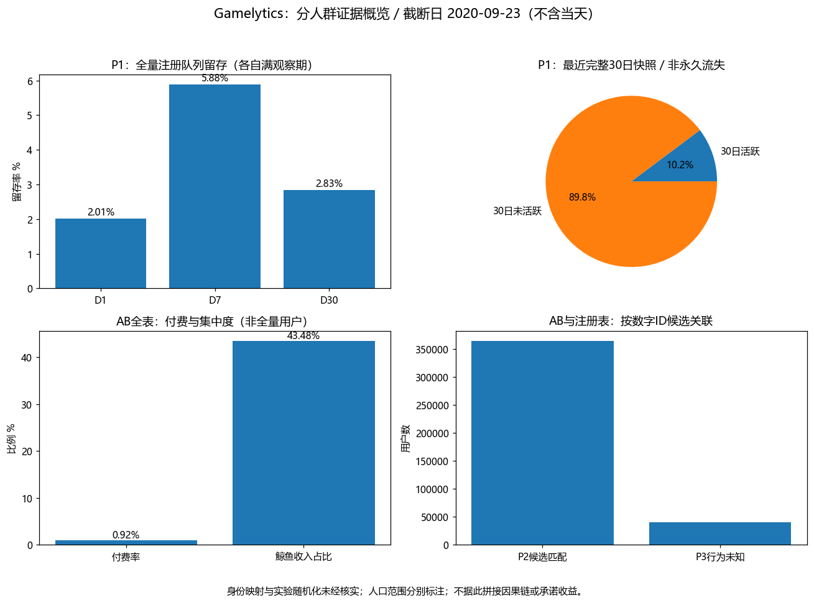
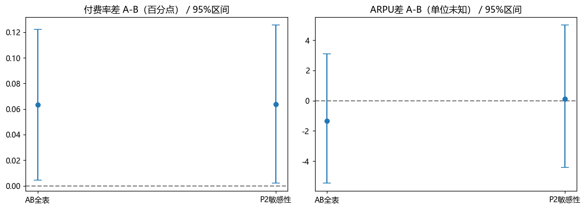
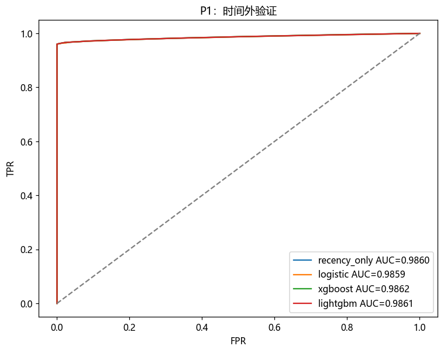

# Gamelytics：可复核的游戏数据分析

围绕一个问题：**AB表中的付费差异，是否足以支持采用某个方案？**
项目价值是数据审计、口径统一、SQL复核与有边界的决策，不声称真实上线或收入提升。

## 先看结论

- 数据为100万注册、9,601,013条登录、404,770条AB记录。来源/生成脚本和实验协议未获核实，原称合成数据，结果不作真实业务外推。
- AB数字ID有9.94%无法匹配注册；匹配集合恰为最早36.4555%的注册用户。数字相等不等于身份映射已证实。
- AB全表付费率差A-B为0.0633个百分点（名义p=0.0350）；ARPU差95%区间为[-5.46, 3.09]。**目前证据不足以建议全量上线**，不是已证明无差异。
- 相邻90日日均DAU增长由新老用户共同贡献，撤回“全靠拉新”的旧结论。完整日期与各指标分母见口径文档。
- 时间外测试近期性基线AUC=0.9860、XGBoost=0.9862；Top10%预算下无命中优势，不能据高AUC宣称召回收益。

## 交付与证据

| 内容 | 入口 |
| --- | --- |
| 数据审计、六条旧headline台账 | [审计报告](docs/data_audit.md) |
| 人群/时间窗口/指标合同 | [指标口径](docs/metric_contract.md) |
| AB问题、备选动作、成本假设与验证 | [一页决策案例](docs/decision_memo.md) |
| 5条SQLite查询、与Pandas逐项/逐行对账 | [SQL](sql/) / [执行证据](reports/sql_reconciliation/checks.json) |
| 模型、基线、固定预算、修复状态 | [验证报告](docs/validation.md) |
| 可运行说明与故障排查 | [Runbook](docs/runbook.md) |
| 三分钟讲解、简历表述 | [面试材料](docs/interview_notes.md) |

## 快速运行

```bash
python -m pip install -r requirements-dev.txt
python run_all.py
```

需本地data/的三份原始CSV，来源未核实且文件不随仓库发布。SQLite为Python内置，无需额外数据库服务；脚本记录日志，失败即停止。数据库在data/audit.sqlite，可重建且不入库。输入指纹见reports/data_audit/summary.json；验证环境见reports/environment.json。

## 分析范围

P1使用完整日期注册与登录，做健康度、留存、预测。AB全表做收入和A/B主比较。P2为候选匹配早期队列，条件性分析行为分群；P3行为未知，不填0、不参与行为分群。P2仅为实验敏感性分析，不能取代全表。
分析统一排除2020-09-23可能不完整当天，快照为当天00:00（exclusive）；首次审计保留旧快照用于追溯。留存为各自满观察期人群，模型仅定义day14..27未登录，不是永久流失。

## 当前看板







## 已知限制

共同用户ID体系、随机分组机制、实验周期、收入单位/窗口、成本与护栏未知。分组均衡不证明随机化；事后p值只作名义证据。模型预测关联不能识别因果或可挽回人群。没有完整行为事件链，不做多步转化漏斗；没有实际干预，不写“推动”“提升收益”。
原笔记本保留为历史入口，可能含旧输出；当前结果以run_all.py生成文件为准。BI按目标岗位需求再选做，本次保留静态单页看板。
