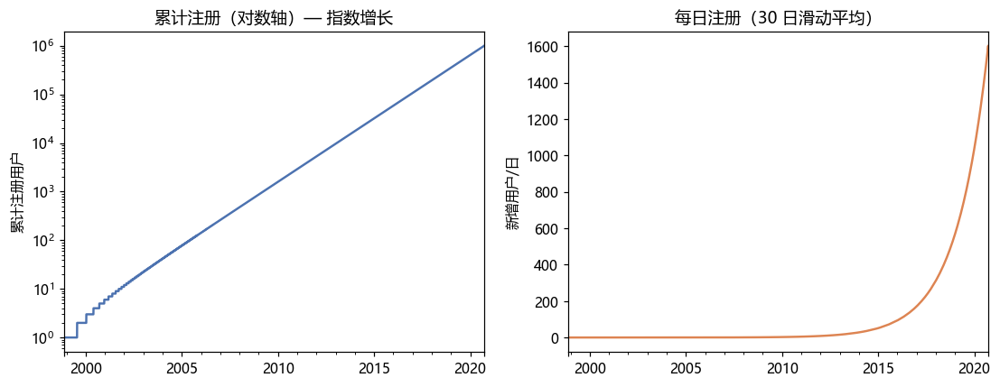
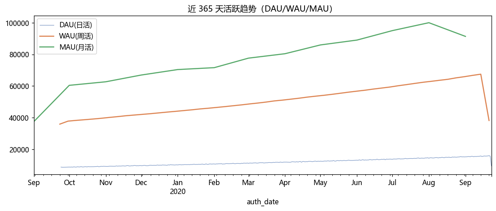
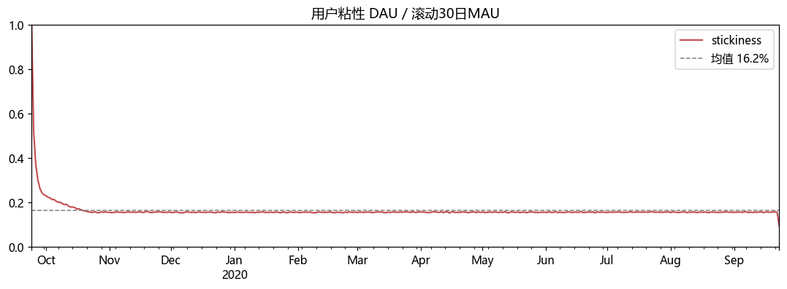
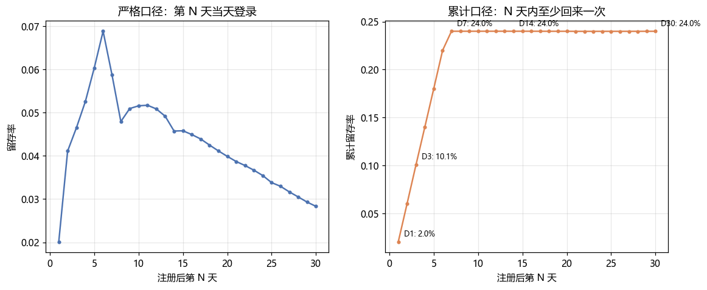
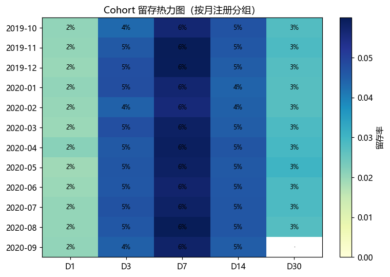
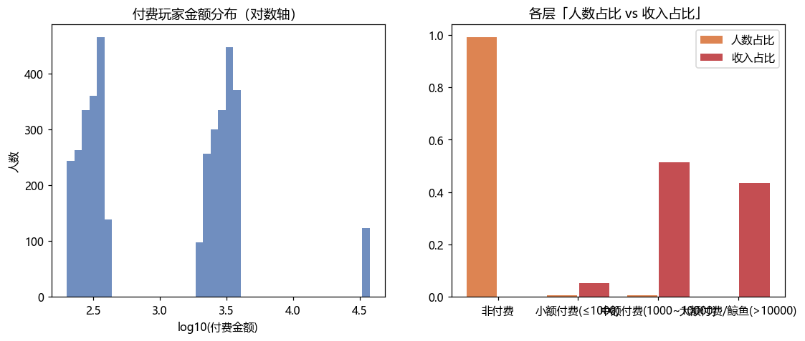
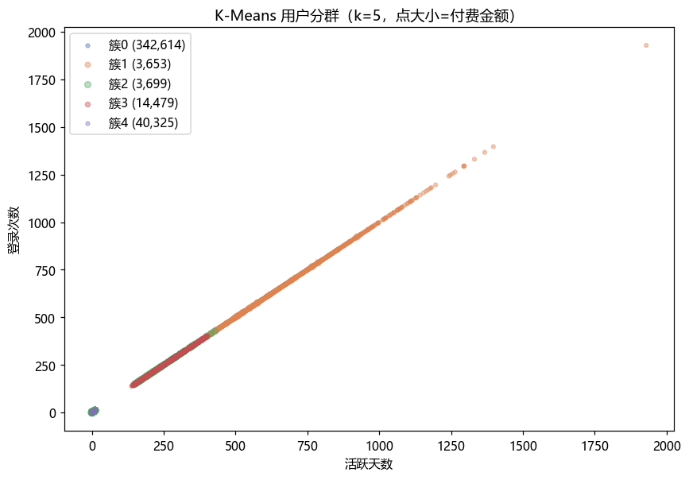
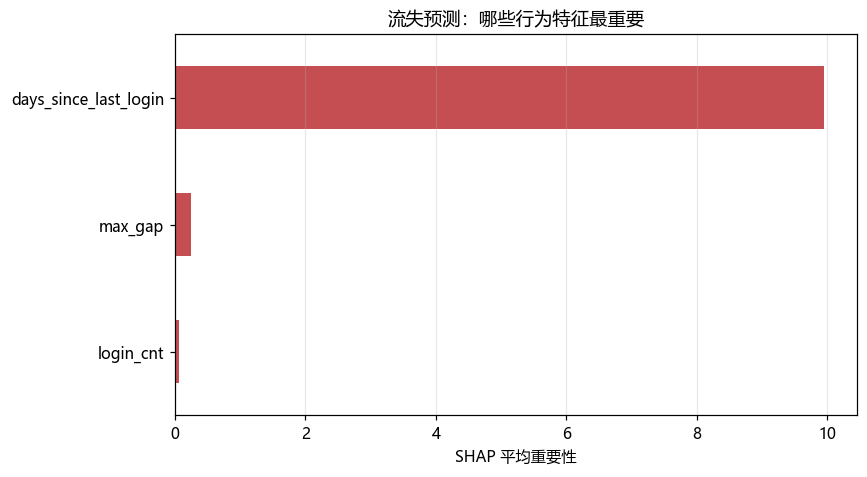

# 游戏运营数据分析（Gamelytics）

> 对一个拥有 **100 万注册用户** 的 F2P（免费下载、内购变现）游戏，做从「运营健康度 → 留存 → 付费变现 → 用户分群 → 流失预测」的**完整业务数据分析**，最终给出可落地的运营建议。

这是一份业务分析项目（不是纯建模竞赛）：重点是**口径严谨 + 结论能指导决策**，模型只是把描述性分析升级成预测性分析的一环。

---

## 项目概览

| 维度 | 内容 |
|------|------|
| 数据 | Gamelytics 游戏数据集：注册表 100 万 + 登录表 960 万 + AB 测试表 40.5 万 |
| 分析链路 | 6 个模块，从「盘子多大」到「谁在流失、为什么流失」 |
| 关键方法 | 留存分析、Cohort 热力图、鲸鱼经济、A/B 检验、RFM、K-Means、流失预测模型 + SHAP |
| 工具 | Python · pandas · numpy · matplotlib · scipy · scikit-learn · XGBoost · LightGBM · SHAP |

**一句话结论**：这是一个「**增长靠拉新、留存质量不涨、付费极低且高度集中、付费用户已经整体沉睡**」的高流失游戏。

---

## 数据说明

三张分号分隔的 CSV（时间戳为 Unix 秒）：

| 表 | 行数 | 字段 | 含义 |
|----|------|------|------|
| `reg_data.csv` | 100 万 | `uid`, `reg_ts` | 用户注册记录 |
| `auth_data.csv` | 960 万 | `uid`, `auth_ts` | 用户登录日志 |
| `ab_test.csv` | 40.5 万 | `user_id`, `revenue`, `testgroup` | 累计付费金额 + 推广分组 a/b |

**数据特点**（分析前先摸清楚，避免踩坑）：
- 时间跨度 1998–2020，注册量**指数增长**（合成数据）
- 每个用户**注册当天都有一次登录**（注册 = 首次登录）
- 每个活跃天**恰好登录 1 次**（`login_cnt == active_days` 恒成立）——这决定了后续特征工程不能盲目堆「登录强度」之类的冗余特征

---

## 分析框架（6 个模块）

| 模块 | 回答的问题 | 主要产出 |
|------|-----------|---------|
| 1 运营健康度 | 盘子多大？还在涨吗？粘性如何？ | DAU/WAU/MAU、粘性、注册增长 |
| 2 留存分析 | 用户能留多久？留存变好还是变差？ | D1/D7/D30、Cohort 热力图 |
| 3 付费变现 | 多少人付费？收入集中在谁身上？A/B 有效吗？ | 付费率/ARPU/ARPPU、长尾、A/B 检验 |
| 4 用户分群 | 用户能分成哪几类？ | RFM 分群 + K-Means 聚类 |
| 5 流失预测 | 谁要流失？为什么？ | 特征工程 + 模型对比 + SHAP |
| 6 结论建议 | 到底出了什么问题？先做什么？ | 诊断仪表盘 + 行动建议 |

---

## 核心发现

### 模块 1 · 运营健康度 —— 增长全靠拉新

- 累计注册 **100 万**，注册量指数增长；近 12 个月日均 DAU **11,883**、平均月活 **76,092**
- 粘性 DAU/MAU = **16.2%**（行业健康值约 20%+，偏低）
- DAU 近 90 天比前 90 天涨 **+57.2%** —— 但结合模块 2，这波增长是**新增用户推上去的，不是留存变好**

> 结论：表面增长健康，实际是「拉新驱动」，需要看留存质量（模块 2）。

### 模块 2 · 留存分析 —— 第 1 天就断崖

- 严格口径留存：**D1 = 2.0%，D7 = 5.9%，D30 = 2.8%**（D1 < D7 是因为周登录周期，口径上「当天登录」会有波动）
- 累计口径留存：D7 / D14 / D30 **全部卡在 24%** —— 说明 76% 的用户注册后第 1 天起就再也没回来
- **Cohort 热力图**：按月分组的 D7 留存从 5.65% → 5.76%，**五年基本持平** → 留存质量没有任何提升

> 结论：最大漏点在第 1 天，且产品迭代没有改善留存质量。

### 模块 3 · 付费变现 —— 极低的付费率 + 极端的鲸鱼经济

- **付费率 0.92%**（约 3733 人付费）
- **ARPU = 26.08**，**ARPPU = 2828.23**（是 ARPU 的 **108 倍**）—— 典型的鲸鱼经济：绝大多数人一分钱不花
- 收入集中度：**前 0.03% 的鲸鱼（123 人，revenue > 10000）贡献了 43.5% 的收入**
- **A/B 测试**：付费率 A 组 0.954% vs B 组 0.891%（z=2.1，p=0.035，统计显著），但 **ARPU 差的 95% 置信区间 [-5.48, 3.15] 包含 0** → 付费率差只有 0.06 个百分点，**没有实际意义**

> 结论：收入命脉握在极少数鲸鱼手里；A/B 的「统计显著」≠「业务显著」。

### 模块 4 · 用户分群 —— 鲸鱼已经跑了

- **RFM 分群**：99% 用户不付费，付费用户（0.9%）里「重要价值 0.5% / 待挽留 0.4% / 沉睡付费 0.1%」
- **K-Means（k=5）聚类**：
  - 流失大众 84.6% + 僵尸 10% = **94.6% 的用户已死**
  - 高频白嫖 3.6%（天天玩、不付费）+ 超级活跃 0.9%
  - **沉睡付费 0.9%**（人均付费 2845，距今未登录 1894 天）

> 结论：最扎心的一点——**付费用户（尤其鲸鱼）整体已经沉睡**。付费用户中位距今未登录 **997 天（约 2.7 年）**，鲸鱼中位 **1015 天**。游戏的变现根基已经在流失。

### 模块 5 · 流失预测 —— 近期性是第一信号

- 定义：用注册后 **前 14 天行为** 预测第 14–28 天是否流失（右删失已处理）
- 建模人群流失率高达 **81.67%**
- 特征工程发现冗余：`login_cnt == active_days` 100% 成立、登录强度恒为 1 → 只保留 3 个独立特征（体量 / 近期性 / 连续性）
- **模型对比（5 折交叉验证 ROC-AUC）**：逻辑回归 0.9857 ≈ XGBoost 0.9859 ≈ LightGBM 0.9859（信号近乎线性）
- **SHAP 解释**：`days_since_last_login`（距上次登录天数）重要性 **9.95**，碾压其余特征

> 结论：**「多久没登录」是流失的第一预测因子**。运营抓手：对「7 天未登录」的用户提前干预，而不是等 14 天才挽留。
>
> 诚实说明：AUC 高达 0.99 是因为合成数据流失信号干净；真实游戏里流失更随机（AUC 一般 0.7–0.85）。这里价值在**方法论**（定义 → 特征 → 建模 → 解释）和**特征重要性结论**，不在 AUC 绝对值。

### 模块 6 · 结论 —— 因果链

```
拉新驱动增长 → 留存质量不涨 → 付费极低且集中 → 付费用户整体沉睡 → 90% 盘面已流失
```

---

## 业务建议（按优先级）

**P0 · 止血（先做，ROI 最高）**
1. **召回沉睡付费用户**：鲸鱼 0.03% 贡献 43.5% 收入，却已沉睡约 2.7 年。用 VIP 客服 + 专属回归礼包定向召回，这批人的 LTV 远高于拉新。
2. **上线「7 天未登录」实时预警**：把模块 5 的模型落地成流失预警，对高风险用户自动触发召回推送。

**P1 · 拉留存（短期）**
3. **修 D1 留存**：首日体验优化 + 次日回访奖励。D1 从 2% 提到 5%，LTV 会成倍提升（留存是付费的地基）。
4. **破冰付费**：3.6% 的高频白嫖用户天天玩却不花钱，是最容易转化的金矿，设计首充 / 破冰礼包。

**P2 · 提质量（中期）**
5. **提升留存质量**：Cohort D7 五年持平，说明产品力没提升，需要功能迭代 + 内容更新让留存随版本上升。
6. **A/B 扩样本再验证**：当前付费率差异 p=0.035 但 ARPU 不显著，别急着上线，扩大样本 / 延长观察期再看。

---

## 技术栈 & 技能点（面试对照）

| 技能 | 在项目里的体现 |
|------|--------------|
| 数据清洗 / 口径 | 分号分隔、Unix 时间戳、活跃/留存/流失口径定义、**右删失处理** |
| 指标设计 | DAU/WAU/MAU、粘性、付费率/ARPU/ARPPU、严格 vs 累计留存 |
| 统计检验 | A/B 测试：双比例 z 检验 + Bootstrap 置信区间 + Mann-Whitney U |
| 统计显著 vs 业务显著 | A/B 的 p=0.035 但效果量 0.06pp，ARPU 不显著 |
| 用户分群 | RFM 业务分群 + K-Means（StandardScaler + 肘部法选 k） |
| 特征工程 | 从登录日志聚合行为特征 + **识别冗余/常数特征** |
| 机器学习 | 逻辑回归 / XGBoost / LightGBM，StratifiedKFold 交叉验证 |
| 模型解释 | **SHAP**（TreeExplainer），讲清「为什么流失」 |
| 数据可视化 | 留存曲线、Cohort 热力图、长尾分布、聚类散点、ROC、诊断仪表盘 |
| 业务思维 | 从「增长靠拉新」到「鲸鱼已流失」的因果链推演，按 P0/P1/P2 排优先级 |

---

## 项目结构

```
gamelytics_analysis/
├── data/                    # 三张原始 CSV（gitignore）
├── src/
│   ├── config.py            # 全局路径 + 指标口径定义
│   ├── load.py              # 数据加载 + 时间戳解析
│   └── plots.py             # matplotlib 中文字体 + 存图
├── analysis/
│   ├── 01_health.py         # 运营健康度
│   ├── 02_retention.py      # 留存分析
│   ├── 03_monetization.py   # 付费变现
│   ├── 04_segmentation.py   # 用户分群
│   ├── 05_churn.py          # 流失预测
│   └── 06_conclusion.py     # 结论建议 + 诊断仪表盘
├── figures/                 # 全部图表输出
└── README.md
```

---

## 怎么跑

```bash
pip install pandas numpy matplotlib scipy scikit-learn xgboost lightgbm shap

# 依次运行 6 个模块（每个模块独立输出结论 + 图表）
python analysis/01_health.py
python analysis/02_retention.py
python analysis/03_monetization.py
python analysis/04_segmentation.py
python analysis/05_churn.py
python analysis/06_conclusion.py
```

> 数据文件需放在 `data/` 下（`reg_data.csv` / `auth_data.csv` / `ab_test.csv`），因体积较大未入库，`.gitignore` 已忽略。

---

## 图表一览

**模块 1 · 运营健康度**





**模块 2 · 留存**




**模块 3 · 付费变现**




**模块 4 · 用户分群**



**模块 5 · 流失预测**




**模块 6 · 结论**


